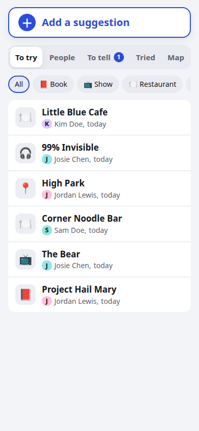
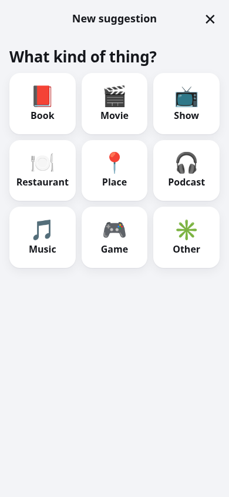
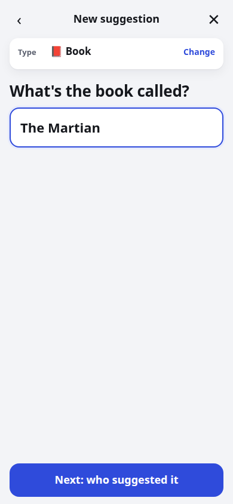
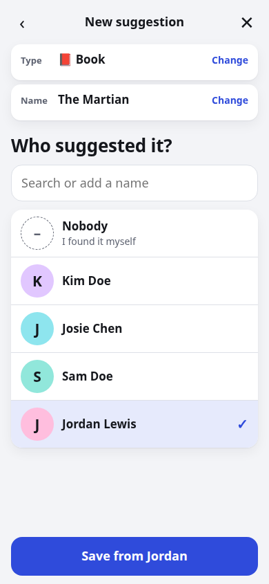
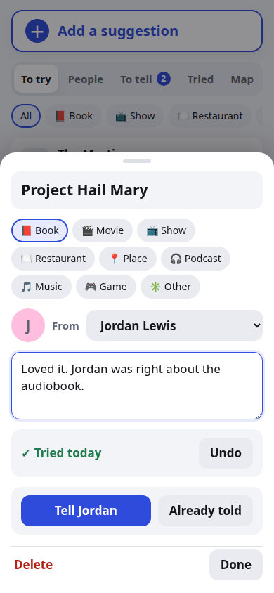

# recs

A small phone web app (installable to the Home Screen) for jotting down suggestions
people give you — books, movies, restaurants, places — and **who** suggested them.
Later you mark one "tried" and the app helps you tell that person.

- FastAPI + SQLite backend (`main.py`), plain JS frontend (`static/`), no build step.
- Works offline-first: new items save locally and sync when online.
- Restaurants/places can be searched on a map (via [Photon](https://photon.komoot.io/),
  OpenStreetMap data); only the place text is sent, never people's names.
- Own login. Signing up needs a setup code, so a public instance stays private.
- "See how it works" on the login screen opens a demo with made-up data. It runs entirely
  in the browser (`static/demo.js`), so the demo never sends anything to the server.

## Screenshots

All data below is made up.

| Your list | Add: pick a type | Add: name it | Add: who suggested it | Mark it tried |
|---|---|---|---|---|
|  |  |  |  |  |

## Run locally

With uvicorn:

```bash
uv venv .venv && uv pip install -p .venv -r requirements.txt
DB_PATH=./scratch.db COOKIE_SECURE=0 RECS_SETUP_CODE=change-me \
  .venv/bin/uvicorn main:app --port 8766
```

Open http://localhost:8766, tap "New here? Set up an account", and enter the setup code.

With Docker:

```bash
docker build -t recs .
docker run -p 8766:8000 -v recs_data:/data \
  -e COOKIE_SECURE=0 -e RECS_SETUP_CODE=change-me recs
```

## Environment variables

| Variable          | Example         | Meaning |
|-------------------|-----------------|---------|
| `RECS_SETUP_CODE` | `change-me`     | Code required to create an account. Empty = sign-up disabled. |
| `DB_PATH`         | `/data/recs.db` | SQLite file location. |
| `COOKIE_SECURE`   | `1`             | `1` = cookie only over HTTPS (production). Use `0` for plain-http local runs. |
| `COOKIE_PATH`     | `/recs`         | Cookie path when served under a sub-path. Default `/`. |

`deploy/` has an example Docker Compose fragment and Traefik config for serving it
under a sub-path (`/recs`) behind a reverse proxy.

## Tests

```bash
node --test tests/parse.test.js tests/demo.test.js
.venv/bin/python -m unittest discover -s tests
```

## License

MIT
